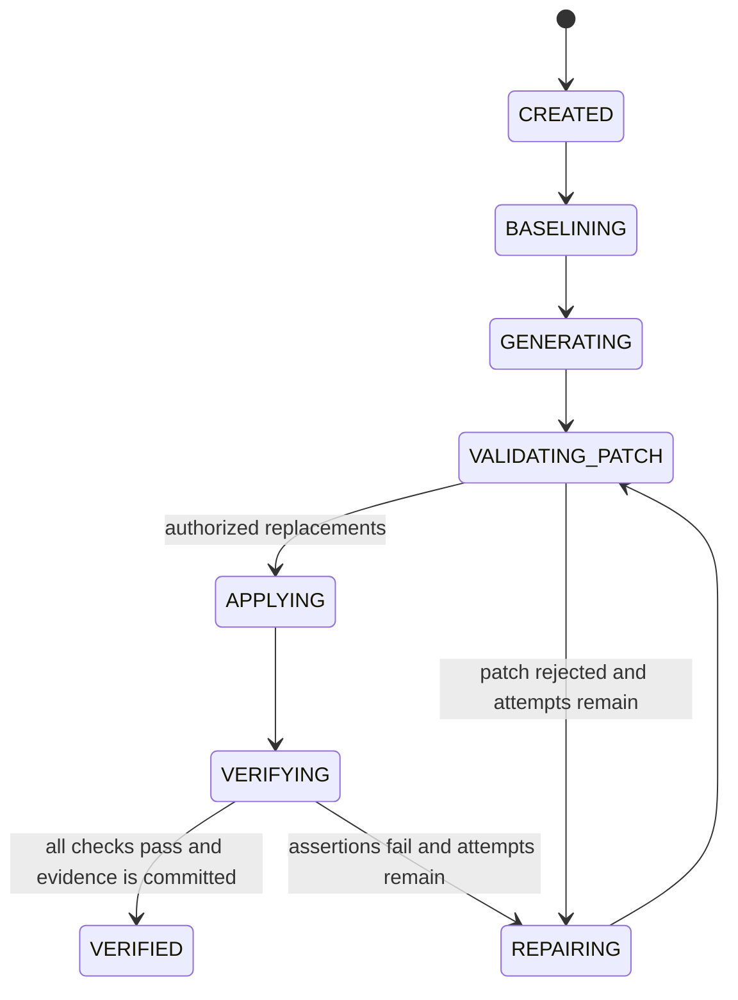

# Architecture

The dashboard on `127.0.0.1:3000` calls a separate Node worker on port `4318`. The worker owns execution and run storage. Eve runs on port `4319` when Live AI is configured to use it. Launch the worker and dashboard separately when testing a dashboard restart during an active run.

| Component | Responsibility |
| --- | --- |
| [Dashboard](../../app/page.tsx) | Starts runs, polls status, and renders provenance and evidence. |
| [Worker](../../runner/worker.mts) | Admits one active run and delegates generation, validation, and browser verification. |
| [Candidate generators](../../runner/generators.mts) | Produce structured full-file replacements from a rehearsal script, Eve, or the direct AI Gateway adapter. |
| [Patch validator](../../runner/patch.mts) | Authorizes replacements and applies them to an in-memory copy. Each repair starts from the latest accepted candidate. |
| [Browser verifier](../../verifier/browser.mjs) | Runs trusted checks and captures screenshots and traces for the exact source delivered to Chromium. |
| [Run store](../../runner/store.mts) | Persists manifests and registered artifacts under `.proofpilot/runs` by default. |

## Run lifecycle

The baseline expects a missing archive control and working task completion. Live AI has three candidate attempts in total. Rehearsal has two scripted attempts. A rejected patch consumes an attempt and leaves the current candidate intact. Exhaustion with unresolved browser assertions produces `FAILED`. Infrastructure failures, unexpected baseline behavior, or exhaustion without a valid candidate reaching verification produce `ERROR`.

The worker writes each artifact and manifest through an atomic rename. It commits `VERIFIED` only after the required checks pass and the evidence has been saved. On worker restart, unfinished runs become `INTERRUPTED` and retain previously registered evidence.

## Execution boundary

The candidate consists of three allowlisted static files. Tests and deterministic seed data are developer-owned. Each verification launches a fresh rootless Podman container with no external network, host mounts, or model credentials. Chromium remains sandboxed under a seccomp profile derived from the local Podman default, with a targeted allowance for Chromium's sandbox `chroot`. The verifier serves only the fixture on a dedicated loopback origin, blocks Service Workers and off-origin requests, and applies process, memory, and time limits.
